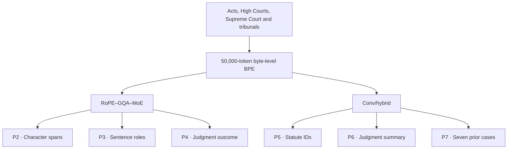
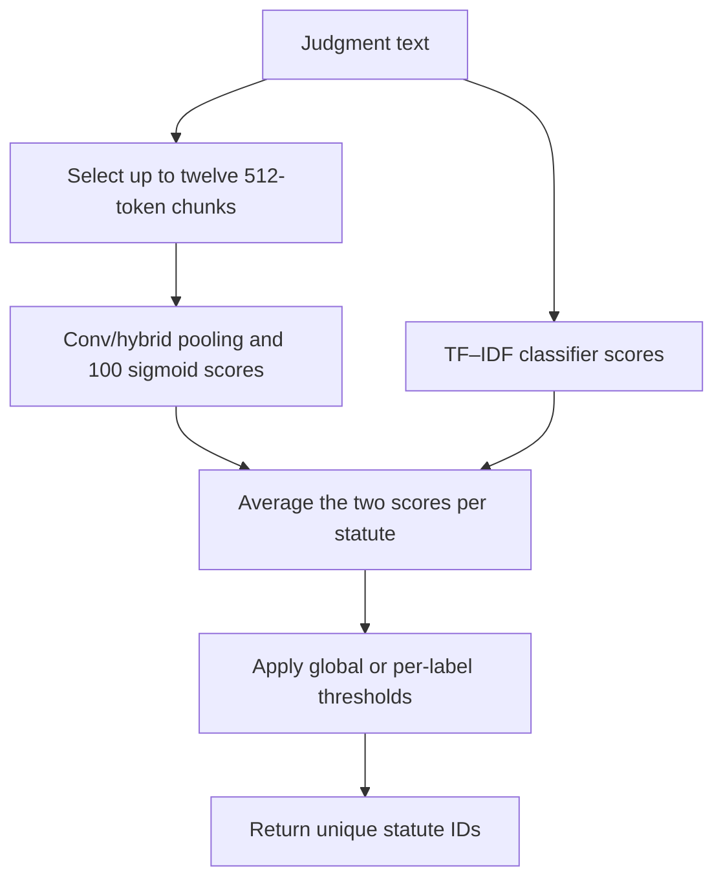

# CS781 Capstone: Legal NLP

Shashwat Shrivastava · IIT Kanpur · CS781

This project explores how far compact, self-hosted language models can go on Indian legal text. The first task trains a model from scratch to continue a legal passage. The next six tasks reuse foundation checkpoints for extraction, classification, summarization and retrieval. The 90.1M-parameter Conv/hybrid was trained after the Phase 1 competition window and used in downstream experiments.

## From pretraining to six legal tasks

The diagram shows the backbone associated with the highest downstream submission that the report could trace to a training run. The phase guides also record experiments with other backbones, adapters, LoRA, LoRMA, prefix tuning and distillation.



## Results

The scores below come from the visible Codabench history. Phase 4 shows the selected submission. The Phase 1 score of 0.8314 was recorded after the phase closed. Rank 70 is the separately reported phase rank.

| Phase | Task | Metric | Best visible finished score | Rank | Finished shown | Submission ID(s) |
| --- | --- | --- | ---: | ---: | ---: | --- |
| 1 | Legal Language Model Pretraining | BERTScore F1 | 0.8314 | 70 | 14 | 964722 |
| 2 | Legal Named Entity Recognition | Strict Macro-F1 | 0.5102 | 77 | 10 | 975846 |
| 3 | Rhetorical Role Prediction | Macro-F1 | 0.4277 | 111 | 12 | 991428, 991425 |
| 4 | Court Judgment Prediction | Macro-F1 | 0.7295 | 64 | 8 | 1003593 |
| 5 | Legal Statute Identification | Macro-F1 | 0.4334 | 16 | 8 | 1010677 |
| 6 | Abstractive Summarization | BERTScore F1 | 0.8448 | 43 | 6 | 1028539 |
| 7 | Prior Case Retrieval | Micro-F1@7 | 0.4324 | 48 | 7 | 1040827 |

Ranks supplied on 9 November 2026. The score column lists the best visible finished submissions. Finished shown includes early test runs that completed successfully; Phase 7 has three additional rows outside the supplied screenshot.

The [Phase 1 model scores](phase1/README.md#model-scores) include a separately reported Conv result of 0.838, SwiGLU at 0.8314 (submission 964722), and the Funnel, encoder–decoder and 50M decoder results. The Conv 0.838 result has no matching row in the supplied screenshot, so the Phase 1 value above remains the best screenshot result.

## Phase 1 models

| Model | Design | Parameters | Context | Available material |
| --- | --- | --- | --- | --- |
| Conv/hybrid | Prefix Transformer with RoPE and gated causal depthwise convolution | 90,061,440 | 2,048 | Model, training utilities and notebooks |
| FunnelTransformer | Local-to-global causal attention; factorized embeddings | 45,327,360 with uploaded defaults | 1,536 | Standalone model, trainer and generator |
| LegalEncDec | 4 encoder and 4 decoder layers with cross-attention | 50,777,088 | 2,048 per stream | Model, training utilities, notebook and local metrics |
| RoPE–GQA–MoE | Rotary positions, 8 query/2 KV heads, 4 experts with Top-1 routing | Approximately 82.44M backbone; LM head excluded | 1,536 | Backbone implementation and partial configuration |

The [architecture notes](docs/architectures.md) cover the attention layouts, layer settings and parameter counts. The MoE count above is for the backbone only; its `model90m.pt` filename is a model label, not a verified full-model count.

All four model files are in [phase1/models/](phase1/models/README.md): [Conv](phase1/models/conv_hybrid.py), [Funnel](phase1/models/funnel.py), [LegalEncDec](phase1/models/legal_enc_dec.py) and [MoE backbone](phase1/models/rope_gqa_moe_backbone.py). Conv and LegalEncDec have training notebooks; Funnel includes a standalone trainer and generator. An additional [fine-grained MoE training script](phase1/models/model_g_legal_lm_2048.py) is included as a separate 2,048-context variant. It does not identify the architecture used for the earlier MoE checkpoint. The phase guides below link the available implementations and experiment records. Loading trained models requires the corresponding checkpoint.

## How the downstream tasks use a judgment

| Phase | Unit of prediction | Reference workflow |
| --- | --- | --- |
| [2 · Named entities](phase2/README.md) | All entity spans in a document | Return start and exclusive end character offsets in the original text, plus one of 12 labels. Strict scoring requires both boundaries and the label to match. |
| [3 · Rhetorical roles](phase3/README.md) | One of 13 roles per supplied sentence | Encode the previous, target and following sentence with sentence-position information. Cap the target at 256 tokens and the combined input at 384. Preserve the supplied sentence order. |
| [4 · Judgment prediction](phase4/README.md) | One binary outcome per case | Select up to six 512-token chunks with greater weight near the end. Gated token pooling produces chunk vectors and attention combines them. The reference run selected a threshold of 0.46 on clean development data. |
| [5 · Statute identification](phase5/README.md) | A set drawn from 100 statute IDs | During training, sample one chunk from each group of adjacent chunks. At evaluation, space chunks across the document. Blend the hierarchical classifier with lexical scores and threshold each statute. |
| [6 · Summarization](phase6/README.md) | One generated summary per judgment | Pack ranked passages or head-and-tail text into a 2,048-token decoder context, reserving up to 768 tokens for the summary. Keep duplicate judgments together in the validation split. |
| [7 · Prior-case retrieval](phase7/README.md) | Seven distinct candidate IDs per query | Encode each side with the same Conv/hybrid. Pool up to three 384-token chunks into document and segment vectors. Train with relevant cases, lexical hard negatives and a random negative, then rank the candidate pool for that split. |

### How statute scores become predictions

More than half of the documents in each Phase 5 split exceeded 512 tokens. A judgment can cite several statutes, so the classifier scores each label independently. This diagram follows the Conv/hybrid reference implementation.



### Data and evaluation splits

Phase 2 uses two annotated training folds and a third test fold. Phase 3 supplies separate Corporate Law and Information Technology files, with 16,845 training sentences across the two domains. The Phase 4 reference run split 31,652 unique training texts into 28,487 fitting and 3,165 validation examples, then evaluated on a separate 994-case clean development set.

Phase 6 had 7,028 usable judgment–summary pairs before holdout. Median lengths were 3,129 words for judgments and 638 for summaries. In Phase 7, the train, development and test splits had 827, 118 and 237 queries against pools of 4,320, 1,023 and 1,727 candidates respectively. Some candidate cases appear in multiple pools, so retrieval evaluation uses the candidate IDs supplied for each query's split.

## Running the code

```bash
python -m venv .venv
source .venv/bin/activate
python -m pip install -r requirements.txt
```

Use the Python and PyTorch versions from the training environment. The models need PyTorch support for scaled dot-product attention and non-reentrant activation checkpointing. `requirements.txt` covers the model code; `requirements-phase1.txt` lists the tokenizer, data and evaluation dependencies used by the notebooks.

To instantiate LegalEncDec:

```python
from phase1.models.legal_enc_dec import LegalEncDec, ModelConfig

model = LegalEncDec(ModelConfig())
print(sum(p.numel() for p in model.parameters()))
```

To load the MoE backbone from an existing checkpoint:

```python
from phase1.models.rope_gqa_moe_backbone import build_backbone

backbone = build_backbone("checkpoints/model90m.pt").eval()
# backbone(input_ids).last_hidden_state has shape (batch, sequence, 512).
```

The MoE checkpoint must include its original configuration, including `qk_norm` and `rope_theta`. This loader returns hidden states and leaves out the generation head. Conv is in `phase1/models/conv_hybrid.py`. Funnel's uploaded defaults are in `phase1/configs/funnel_standalone.json`; `phase1/configs/funnel.json` retains the earlier specification. The uploaded source uses FFN width 2,048, while that earlier specification used 2,496.

### Kaggle notebooks

| Notebook | Purpose |
| --- | --- |
| [Conv 90M / 800M Run-All](phase1/notebooks/CS781_90M_800M_RunAll_Kaggle.ipynb) | Resumable Conv pretraining and local evaluation; 800M-token requested budget |
| [LegalEncDec 50M / 300M](phase1/notebooks/CS781_EncDec_50M_300M_Kaggle.ipynb) | Encoder-decoder pretraining and local evaluation; 300M-token requested budget |
| [Conv 10-hour version](phase1/notebooks/LegalPrefixConv_90M_10Hour_Training_Evaluation.ipynb) | Earlier bounded training/evaluation workflow |
| [Conv 89M version](phase1/notebooks/LegalPrefixConv_89M_Kaggle.ipynb) | Historical notebook version; includes official-test submission packaging |

The notebooks retain their original contents and have no saved execution outputs. The 800M- and 300M-token figures are configured budgets; completed token counts need the training logs. The two Run-All notebooks' model, data, training and generation modules are also extracted under `phase1/runs/`.

For Kaggle setup, recovery backups and resuming a run, see the [notebook guide](phase1/notebooks/README.md). The notebooks keep Kaggle's installed CUDA-enabled PyTorch. Original filenames and hashes are in [the source manifest](docs/recovered_sources.json).

## Repo layout

| Directory | Task | Primary metric |
| --- | --- | --- |
| [phase1](phase1/README.md) | Legal language model pretraining | BERTScore F1 |
| [phase2](phase2/README.md) | Legal named entity recognition | Strict Macro-F1 |
| [phase3](phase3/README.md) | Rhetorical role prediction | Macro-F1 |
| [phase4](phase4/README.md) | Court judgment prediction | Macro-F1 |
| [phase5](phase5/README.md) | Legal statute identification | Macro-F1 |
| [phase6](phase6/README.md) | Abstractive summarization | BERTScore F1 |
| [phase7](phase7/README.md) | Prior case retrieval | Micro-F1@7 |

Phase 8 was still TBA in the course brief used here. The remaining folders are:

- [experiments/](experiments/README.md): run-record template and the details needed to reproduce a submission.
- [results/](results/README.md): Codabench history and the separate local evaluation.
- [docs/](docs/requirements.md): architecture notes, checkpoint details, course requirements and remaining work.
- [report/](report/README.md): final report and submission archive layout.

## Local evaluation

The LegalEncDec evaluation screenshot reports **32 examples**, with generation completed for 32/32 examples and evaluator exit code 0.

| BERTScore F1 | ROUGE-L F1 | BLEU-4 |
| ---: | ---: | ---: |
| 0.812633 | 0.163818 | 0.020662 |

This is a local run, separate from the Codabench results. Its checkpoint, split, decoding settings and run command are not yet recorded. Details are in [results/README.md](results/README.md).

### Controlled comparisons

| Phase | Change within the same run | Baseline dev Macro-F1 | Variant dev Macro-F1 | Difference |
| --- | --- | ---: | ---: | ---: |
| 3 | Evaluate epoch 3 with exponential moving average weights | 0.406192 | 0.410650 | +0.004458 |
| 5 | Tune the decision threshold on epoch 2 predictions | 0.34599 | 0.35655 | +0.01056 |

The Phase 5 gain was measured on the development data used to tune the threshold. In a separate Codabench comparison, Conv/hybrid summarization scored 0.8448 with full fine-tuning and 0.8440 with LoRA. That pair provides a single-run comparison. See the [notebook run records](experiments/notebook_run_records.md) for local metrics, settings and checkpoint-selection details.

## Data, weights and experiment records

The official dataset is [Exploration-Lab/CS-781-Capstone](https://huggingface.co/datasets/Exploration-Lab/CS-781-Capstone). The project uses a **custom-trained 50k byte-level BPE tokenizer**, stored in [phase1/tokenizer/legal_bpe_50k_fixed.json](phase1/tokenizer/legal_bpe_50k_fixed.json). Its 50,000-token vocabulary includes PAD, UNK, BOS and EOS. See the [tokenizer guide](phase1/tokenizer/README.md) for special-token IDs and loading instructions. The evaluator is in `phase1/evaluation/evaluate_phase1.py`; both files match the copies embedded in the Run-All notebooks.

Keep datasets in `data/`, weights in `checkpoints/`, and generated files in `outputs/`. These folders are excluded from Git. [Checkpoint notes](docs/checkpoints.md) list the information needed to load the weights again. Each [experiment record](experiments/README.md) should connect a submission ID to its code commit, configuration and checkpoint, with local and Codabench scores recorded separately.

The [requirements checklist](docs/requirements.md) tracks the remaining deliverables. The brief's opening asks for four Phase 1 submissions and six per phase for Phases 2–7, although some later sections still say four. It also requires LORMA and knowledge distillation in Phases 2–7, and all four Phase 1 architectures in Phases 2–6. The checklist keeps these requirements and the conflicting data rules together; current course announcements take priority.

## Report

The final report covers corpus analysis, architecture choices, transfer experiments, results and error analysis. The [report guide](report/README.md) describes the submission archive layout. The [references](docs/references.md) list the papers behind the model designs and training methods.

## Repository access

GitHub: https://github.com/GenHavoc/CS-781-Capstone

```bash
git clone https://github.com/GenHavoc/CS-781-Capstone.git
cd CS-781-Capstone
```

The repo is private. Evaluators need access to review it.
